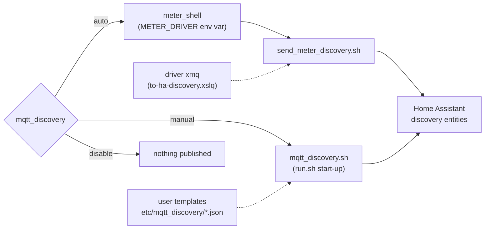

# Discovery pipeline

MQTT discovery generated from the driver sources, decision 0004; the
three modes select which pipeline publishes, decision 0006.

The generator is driver driven: no per-driver json is maintained any
more, the hand written templates are only published in the `manual`
mode. Status flag shaping is being negotiated in wmbusmeters#2092;
the former standalone discussion was issue/PR #927.